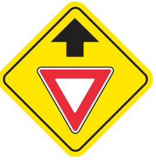
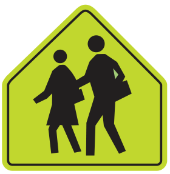
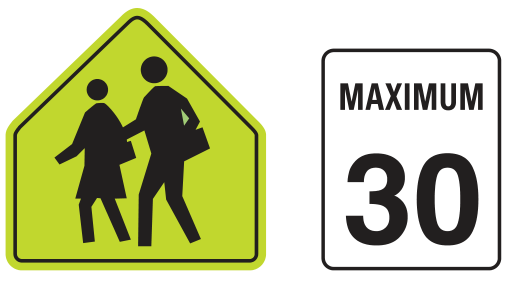

# Sign-picture review

## What was checked

The built-in question-to-picture mappings were reviewed, starting with 47 distinct image files.
The revised app uses 48 distinct files: 36 source-handbook illustrations (35 replacements plus a
new school-zone comparison) and 12 project schematics. Official artwork is cropped from the
Government of Alberta’s Spring 2026 Driver’s Guide; Ontario sign meanings and lane-line wording
were cross-checked against the official MTO handbook.[1][2][4]

This is a sign-picture/mapping review, **not a fresh legal/content audit of every text-only question**.
Jurisdictions may use different sign variants and laws. New imported/AI-generated sets still require
human review against their own official handbook. Existing browser-local imported sets are not
silently rewritten by updating the built-in source files.

## The two reported examples

| Example | Problem | Correction |
|---|---|---|
| Yield ahead | The old drawing omitted the black upward arrow above the yield triangle | Replaced with the actual handbook image, printed page 33; alt text describes the arrow and triangle |
| School warning | Stick figures were a poor representation, and “school zone or area” blurred Alberta’s distinction | Replaced with handbook schoolchildren artwork; Alberta asks about a school area without an attached speed sign; a separate question shows the school sign with MAXIMUM 30 |

In Alberta, a school sign **without** an attached speed sign denotes a school area. The handbook
separately describes a school zone with an attached maximum-speed sign. The Ontario handbook calls
the fluorescent five-sided school symbol a school-zone warning; the Ontario answer retains its own
jurisdiction’s wording rather than copying the Alberta distinction.[1][2]

| Yield ahead | School area | School zone example |
|---|---|---|
|  |  |  |

## Additional corrections found

- Replaced the US-style circular railway warning with a Canadian handbook railway-ahead symbol.
- Replaced the wrong playground shape with the handbook’s yellow diamond and child-with-ball symbol.
- Corrected keep-right, two-way traffic, stop-ahead, no-passing and other simplified sign artwork.
- Updated alt text where the official picture differs: no “YIELD” letters when none are shown,
  two cars rather than opposing arrows for no-passing, and the actual colours and directions.
- Corrected the reserved-lane diamond explanation: the symbol alone does not specify every eligible
  vehicle. The full pictured bus/taxi sign is now asked about as buses **and taxis**, not buses alone.
- Matched the detour question to the pictured “DETOUR NEXT 8 km” sign rather than an invented turn arrow.
- Matched the hospital question’s colour to the green Alberta handbook service sign.
- Aligned Ontario’s solid-line answer with the handbook’s wording: “unsafe to pass.”[4]
- Corrected the schematic roundabout vehicle to point along counter-clockwise circulation, rather
  than radially out of the roundabout.
- Removed unsafe synonym substitutions from optional generation: moose/cattle are not illustrated
  as deer; school crossings are not school areas; left-lane endings are not right-lane endings;
  narrowing lanes are not ending lanes. Only exact curated matches are attached.

The official sign meanings and artwork in this section are grounded in the guides, not generated
by an image model.[1][2] The sources below are study references, not an endorsement of this app.

## Complete official-crop inventory

All entries below come from source [1]. “Page” means the **printed handbook page**, not the PDF
viewer page; this PDF has a two-page offset. `tools/sign_assets.json` stores both numbers,
reviewed crop rectangles, the source PDF checksum and a checksum for each embedded PNG.

| Image | Printed page | Review result |
|---|---:|---|
| `animal-crossing.svg` | 34 | Official handbook crop |
| `bicycle-crossing.svg` | 34 | Official handbook crop |
| `bump.svg` | 35 | Official handbook crop |
| `bus-lane.svg` | 28 | Official handbook crop |
| `construction-worker.svg` | 37 | Official handbook crop |
| `curve.svg` | 33 | Official handbook crop |
| `detour.svg` | 37 | Official handbook crop |
| `disabled-parking.svg` | 32 | Official handbook crop |
| `donotenter.svg` | 26 | Official handbook crop |
| `flag-person.svg` | 37 | Official handbook crop |
| `gas-services.svg` | 36 | Official handbook crop |
| `hospital.svg` | 36 | Official handbook crop |
| `hov-diamond.svg` | 28 | Official handbook crop |
| `keepright.svg` | 27 | Official handbook crop |
| `lane-ends.svg` | 35 | Official handbook crop |
| `merge.svg` | 34 | Official handbook crop |
| `no-bicycles.svg` | 30 | Official handbook crop |
| `no-pedestrians.svg` | 30 | Official handbook crop |
| `no-trucks.svg` | 30 | Official handbook crop |
| `noleft.svg` | 29 | Official handbook crop |
| `noparking.svg` | 30 | Official handbook crop |
| `nopass.svg` | 29 | Official handbook crop |
| `nouturn.svg` | 29 | Official handbook crop |
| `oneway.svg` | 27 | Official handbook crop |
| `ped.svg` | 34 | Official handbook crop |
| `playground.svg` | 32 | Official handbook crop |
| `railway.svg` | 34 | Official handbook crop |
| `school-zone.svg` | 30 | Official handbook crop |
| `school.svg` | 31 | Official handbook crop |
| `signal-ahead.svg` | 33 | Official handbook crop |
| `speed50.svg` | 27 | Official handbook crop |
| `stop-ahead.svg` | 33 | Official handbook crop |
| `stop.svg` | 26 | Official handbook crop |
| `twoway.svg` | 27 | Official handbook crop |
| `yield-ahead.svg` | 33 | Official handbook crop |
| `yield.svg` | 26 | Official handbook crop |

## Remaining schematic inventory

These files were visually reviewed as teaching diagrams, **not represented as official sign artwork**:

| File | Review scope |
|---|---|
| `crosswalk.svg` | White bars across a roadway; question identifies a pedestrian crossing |
| `fourway.svg` | Simultaneous arrival with car 2 on the learner’s right |
| `uncontrolled.svg` | Uncontrolled intersection with car 2 approaching from the right |
| `leftturn.svg` | Left-turning learner and opposing vehicle; question supplies the green-light context |
| `roundabout.svg` | Entering learner yields to circulating vehicle; red vehicle direction corrected |
| `mark-solidyellow.svg` | Solid centre-line diagram; Alberta and Ontario wording kept separate |
| `mark-brokenyellow.svg` | Dashed centre-line diagram; browser dash rendering checked |
| `mark-white.svg` | White lane divider with both cars travelling the same direction |
| `route-marker.svg` | Generic route-number illustration, not a reproduction of a government crest |
| `signal-red.svg` | Red lamp illuminated at the top |
| `signal-yellow.svg` | Amber lamp illuminated in the middle |
| `signal-greenarrow.svg` | Red lamp plus a green left arrow; question is about movement in that direction |

## Rebuild, safety and licensing

### Automatic pictures during handbook import

`tools/handbook_images.py` recognizes the exact reviewed source PDF by checksum and automatically
uses its 36 bundled, checksum-verified PNG crops with the checked question/answer/alt mappings.
No model is used to draw symbols, infer captions or decide which similar sign is pictured.
These pictures are embedded in the generated JSON with source pages and attribution; they do not
require a fresh crop review on every import of this same handbook edition.

Request 36 questions for the complete picture-only set, with automatic test format. More questions
can be generated as text by the optional local model. Other PDFs/editions get a visible warning and
no guessed pictures. A new source profile needs its own artwork and teaching review first.
Nearest-caption extraction remains an inspection aid, not an automatic grading authority.

### Rebuilding the bundled artwork

Download the exact official PDF to an untracked local folder, install the optional PyMuPDF package,
then run:

```sh
python tools/rebuild_sign_assets.py --pdf /path/to/official-guide.pdf
python -m unittest discover -s tests -v
node --test tests/security.test.cjs
```

The builder rejects a changed PDF checksum. It crops reviewed rectangles and wraps each PNG inside
an SVG so existing app URLs remain stable. It does not redraw the symbol, embed the full PDF, copy
page headers/government logos, or fetch anything at runtime. Images remain local; no third-party
image request or tracking endpoint is added. Crop hashes catch accidental replacement, but do not
by themselves prove teaching correctness: visual comparison is still required.

**Contains information licensed under the Open Government Licence – Alberta.** Source attribution
and the licence link must remain with these images; the software MIT licence does not replace the
source-information licence. This project has no official government status or endorsement.[3]

## Sources

[1] https://open.alberta.ca/dataset/387f4e8a-6c0a-456a-ab31-995aadaf1f2b/resource/5babee5c-040d-4e41-981a-04f22e839aac/download/tec-drivers-guide-2026.pdf
[2] https://www.ontario.ca/document/official-mto-drivers-handbook/signs
[3] https://open.alberta.ca/licence
[4] https://www.ontario.ca/document/official-mto-drivers-handbook/pavement-markings